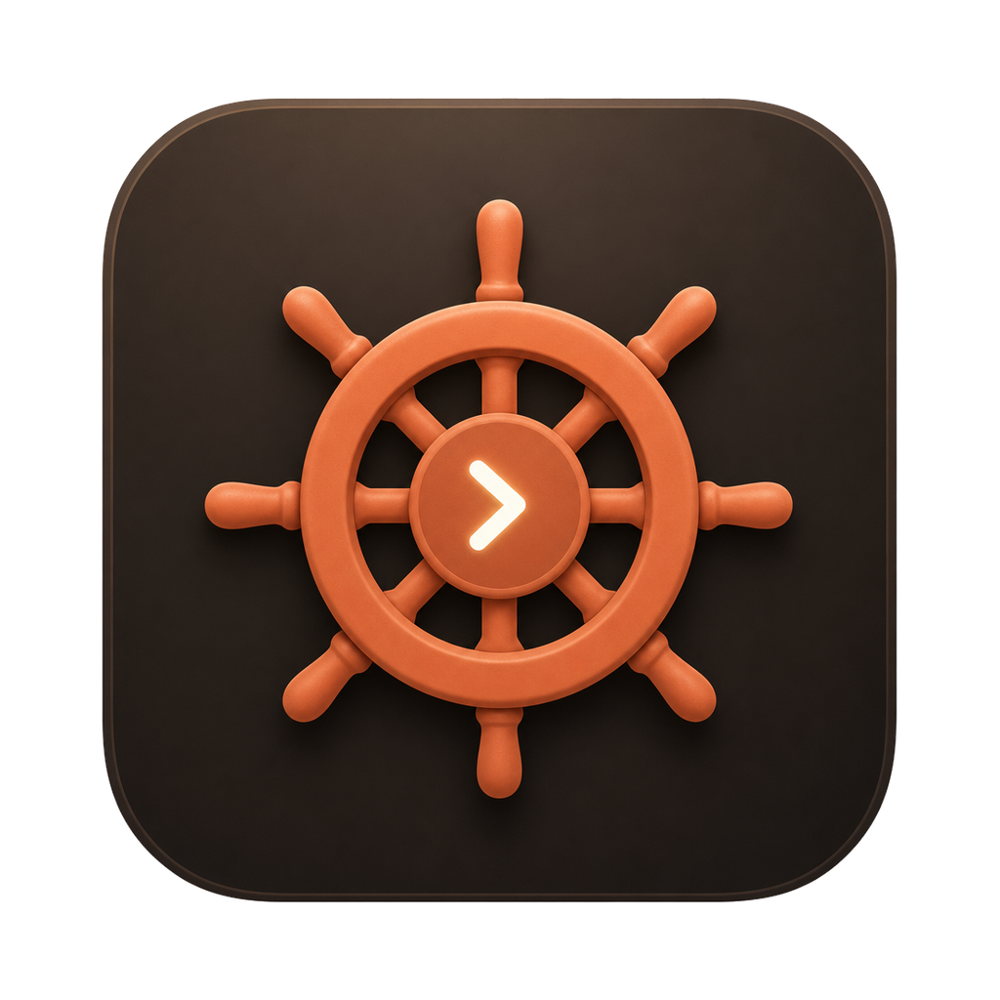

<p align="center">
  
</p>

<h1 align="center">PilotHouse</h1>

<p align="center">
  One fast, native desktop app for working with coding agents.<br>
  Chat with Claude Code, Codex, Gemini CLI or Antigravity, with your code, Git, a board, terminals, a browser and Android devices beside the chat, and let the agents use them too.
</p>

<p align="center">
  <a href="https://github.com/LibreGuild/PilotHouse/actions/workflows/ci.yml"></a>
  <a href="LICENSE"></a>
</p>

## Why

A day with coding agents usually means several agent CLIs in terminals, an editor, a Git client, a browser to check the result, an emulator, and a notepad. PilotHouse puts them in one window, keeps every workspace's agents, shells and test runs going while you look at another, and tells you when one needs you.

**Everything stays on your machine.** PilotHouse has no account, no backend and no telemetry. It talks to the agents you installed, to Git, and to the hosts you add yourself (GitHub, for pull requests).

## What it does

- **Workspaces** with any number of folders (each Git repository has its own tools) or none. Switch from the title bar; each workspace has a colour and shows what it is doing: working, needs your answer, tests failing, finished. A workspace can move to a window of its own.
- **Agent chat** over the [Agent Client Protocol](https://agentclientprotocol.com) with Claude Code, Codex, Gemini CLI and Antigravity: tool calls with diffs, plans, permissions, a model picker with effort and mode, `@` mentions of files, definitions, screenshots, logs, pull requests and test runs, checkpoints with restore, hand-off between agents, search across chats, usage, and parallel runs of one prompt in separate worktrees.
- **Code**: a file tree with icons per file type and Git marks, an editor with language servers (diagnostics, hover, definition, references, rename, outline), workspace search, a viewer for multi-gigabyte logs, and *ask about this code*.
- **Git and GitHub**: commit, branches, history graph, stashes, conflicts, blame, review of agent edits per hunk; pull requests in the app, and agent reviews whose findings you post as comments.
- **Board**: a Kanban board agents plan on and work through card by card, through PilotHouse's MCP server.
- **Browser and Android**: a browser pane and Android emulators or phones that you and the agents can see and drive; annotate a screen and send it to the chat.
- **UI tests** recorded from what an agent does, replayed without AI on several screen sizes or devices, compared with accepted screens, and repaired by an agent. A board card can require them to pass before it is Done.
- **Automation**: agent prompts and test runs at set times, or when files change, a commit lands, a pull request opens or checks fail.
- **Inbox and to-dos**, and an offline utilities toolbox (JSON, JWT, hashes, times, cron, regex, SQLite…) for people and agents.

## Install

Download the build for your system from [Releases](https://github.com/LibreGuild/PilotHouse/releases):

| System | File |
|---|---|
| macOS 11+ (Apple silicon and Intel) | `PilotHouse-macOS-universal.dmg` |
| Windows 10/11 (x64) | `PilotHouse-Windows-Setup-x64.exe`, or `PilotHouse-Windows-Portable-x64.zip` |
| Linux (x86-64) | `PilotHouse-Linux-x86_64.AppImage`, `PilotHouse-Linux-amd64.deb`, or `PilotHouse-Linux-x86_64.tar.gz` |

The builds are not code-signed. **macOS:** the first open is blocked; open System Settings → Privacy & Security → **Open Anyway**, or run `xattr -dr com.apple.quarantine /Applications/PilotHouse.app`. **Windows:** if SmartScreen appears, choose **More info → Run anyway**. Every release lists SHA-256 checksums and has [build provenance](https://docs.github.com/actions/security-for-github-actions/using-artifact-attestations) you can check with `gh attestation verify <file> -R LibreGuild/PilotHouse`.

For agents, install the agent CLIs you want to use (`claude`, `codex`, `gemini`, `agy`) and sign in to them; Claude Code and Codex also need Node.js. PilotHouse shows what is missing for each agent.

## Build from source

You need Rust (stable) and `git`. On Linux, also the libraries listed in [docs/development.md](docs/development.md).

```sh
git clone https://github.com/LibreGuild/PilotHouse.git
cd PilotHouse
cargo run --release -p pilothouse
```

`cargo dev` runs a development build with the UI automation socket used by the tests. See [docs/development.md](docs/development.md), and [docs/packaging.md](docs/packaging.md) for installers.

## Documentation

- [User guide](docs/user-guide.md): first steps, the screen, shortcuts.
- [Docs index](docs/README.md): architecture, testing, performance, security, and a short page per feature.

## Contributing

Bug reports, ideas and pull requests are welcome. Please read [CONTRIBUTING.md](CONTRIBUTING.md) and the [Code of Conduct](https://github.com/LibreGuild/.github/blob/main/CODE_OF_CONDUCT.md). Report security problems privately, as described in [SECURITY.md](SECURITY.md).

## License

PilotHouse is licensed under the [Apache License 2.0](LICENSE). It bundles third-party icons under their own permissive licences; see [NOTICE](NOTICE).
