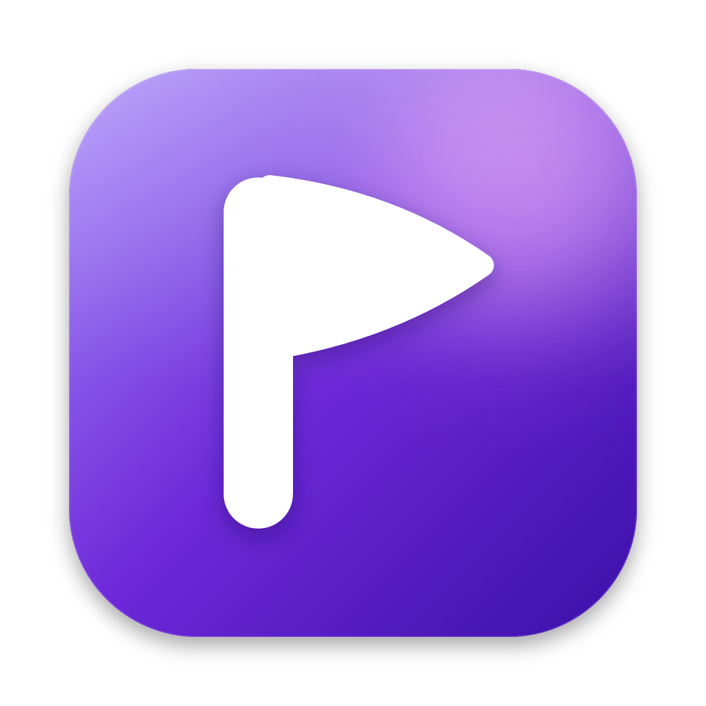
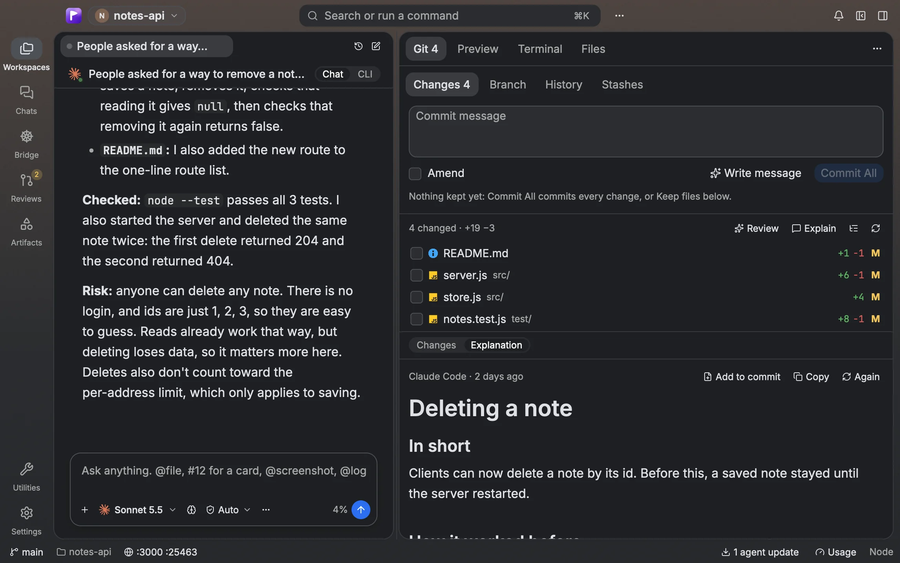
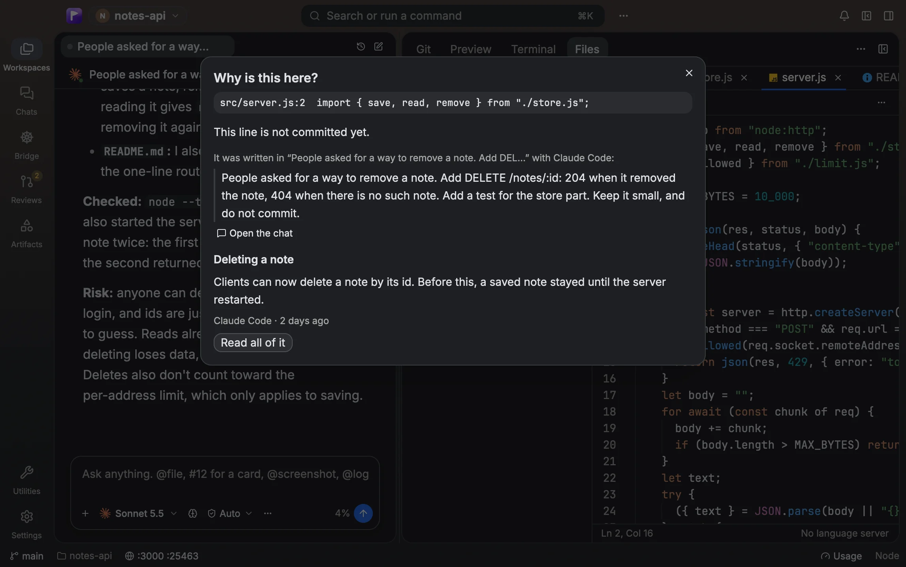
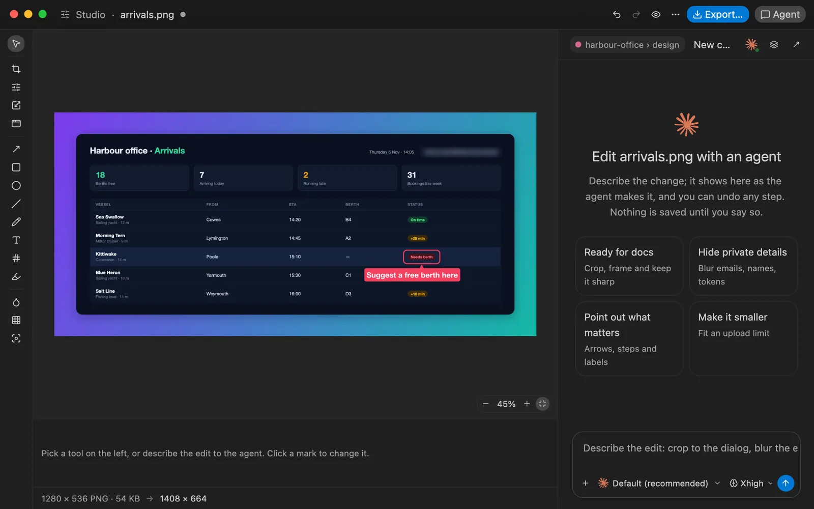
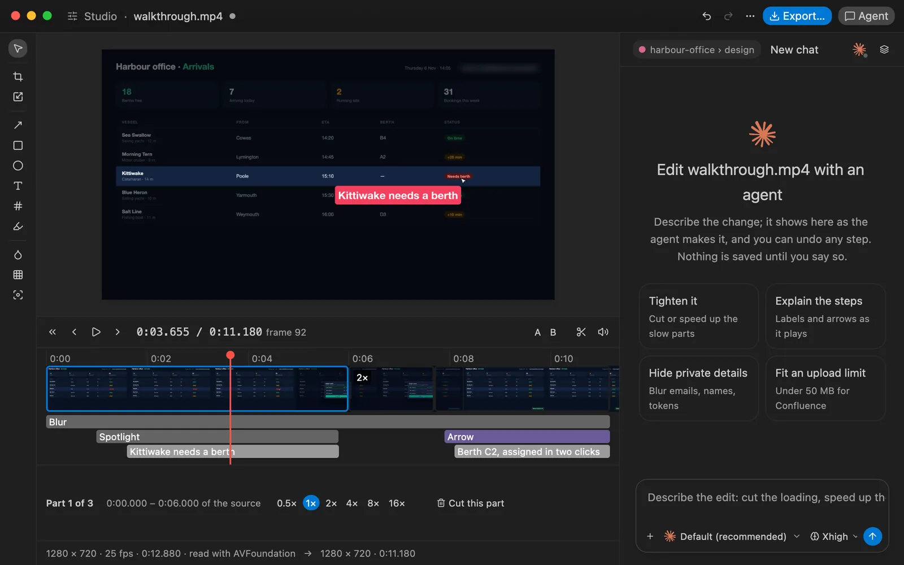
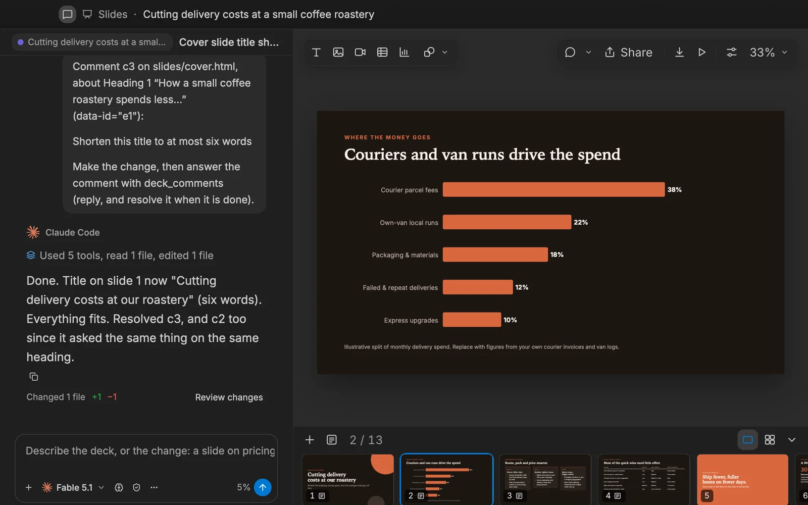

<p align="center">
  
</p>

<h1 align="center">PilotHouse</h1>

<p align="center">
  <b>One window for your coding agents.</b><br>
  Chat with Claude Code, Codex, Gemini CLI, Antigravity or Cline beside your code, Git, terminals, a browser and Android devices, and let the agents use them too.<br>
  A fast, native, open-source desktop app for macOS, Windows and Linux.<br>
  <b>Everything stays on your machine.</b> No account, no backend, no telemetry.
</p>

<p align="center">
  <a href="https://github.com/LibreGuild/PilotHouse/releases/latest"></a>
  <a href="https://github.com/LibreGuild/PilotHouse/actions/workflows/ci.yml"></a>
  <a href="#license"></a>
  
</p>

<p align="center">
  <a href="https://github.com/LibreGuild/PilotHouse/releases/latest"><b>Download</b></a> ·
  <a href="https://libreguild.github.io/PilotHouse/">Website</a> ·
  <a href="docs/user-guide.md">User guide</a> ·
  <a href="#features">Features</a> ·
  <a href="#explain-understand-what-an-agent-changed">Explain</a> ·
  <a href="docs/README.md">Docs</a> ·
  <a href="CONTRIBUTING.md">Contributing</a>
</p>

<p align="center">
  
</p>

## Why PilotHouse

- **One window instead of ten.** A day with coding agents usually means several agent CLIs in terminals, an editor, a Git client, a browser to check the result, an emulator and a notepad. PilotHouse puts them in one window.
- **The agents you already use.** Claude Code, Codex, Gemini CLI, Antigravity and Cline, with your installs and your logins. PilotHouse never sees your credentials.
- **You stay in charge.** Agents ask before they act. Every change is a diff you keep or undo, hunk by hunk, and every message has a checkpoint to go back to.
- **You still understand your code.** Before you commit what an agent wrote, [Explain](#explain-understand-what-an-agent-changed) tells it to you in plain words. It stays with the commit, and any line can tell you why it is there.
- **Many tasks at once, none lost.** The Bridge shows every task of every workspace by what it needs from you: *Needs you*, *Working*, *Ready for review*, *Done*. Work keeps going while you look elsewhere.
- **Agents see what you see.** A browser, Android emulators and phones, and your own Chrome, which you and the agents can both look at and drive.
- **Local first.** No account, no backend, no telemetry. PilotHouse talks to the agents you installed, to Git, and to the hosts you add yourself (GitHub, for pull requests).
- **Native and fast.** One Rust binary of about 20 MB that starts in under half a second and idles near 100 MB of memory ([how that is measured](docs/performance.md)).
- **Open source, and yours to rebuild.** Apache-2.0. An organisation can ship its own build with its name, icons and feature set ([docs/customizing.md](docs/customizing.md)).

## Explain: understand what an agent changed

Agents write the code and agents review it. What gets lost is your own picture of what happened. **Explain** gives it back, where you already are:

- **Before you commit:** *Explain* in the Git tab has an agent read the change and the code around it and tell you, briefly: how this part worked before, what changed, why it was done this way, what was checked and what was not, and what is worth a word with your team. It shows in place of the diff, one switch away.
- **The "why" is real.** It comes from what your chats were asked and what the agent said it did, not from guessing at the code. Where there is no record, it says it is guessing.
- **It stays with the commit.** History shows a commit's explanation, however the commit was made, amended, rebased or squashed.
- **Why Is This Here?** Right-click any line in the editor: the explanation of the change that wrote it, or, for a line not committed yet, the request in a chat that asked for it. No agent runs for this.
- **Share it when you choose.** *Add to commit* writes the explanation as a Markdown file under `.pilothouse/explanations/`, so teammates who pull get it too. Nothing is written without that click.

<p align="center">
  
</p>

More in [docs/features/explanations.md](docs/features/explanations.md).

## Features

### Agents and chat
- **Agent chat** over the [Agent Client Protocol](https://agentclientprotocol.com): tool calls with diffs, plans, permissions, and a model picker with effort and mode.
- **`@` mentions** of files, lines, definitions, screenshots, logs, pull requests and test runs.
- **Checkpoints** before every message, with restore; hand-off of a chat to another agent; a side chat about the one in front.
- **Parallel runs:** one prompt to several agents, each in its own worktree, to compare.
- **Agents in terminals:** an agent CLI in a workspace terminal is followed like a chat (working, needs you, done) and stays in the list once closed.
- **Quick chat:** a small chat window over every app, from anywhere, with a global shortcut (⌥Space; Alt+Shift+Space on Windows and Linux) or `pilothouse quick-chat`.
- **Search across chats, usage,** and an inbox for approvals, reminders and finished runs.

### The Bridge and workspaces
- **The Bridge:** every task in four columns. A card says its branch, what it changed, how it checked that, and its pull request with its checks. Answer an agent's question right on its card.
- **Workspaces** with any number of folders (each Git repository has its own tools) or none. Each has a colour and a dot for what it is doing, and can move to a window of its own; one list, opened from the workspace's name in the title bar, goes between them.
- **Tasks on their own branch:** a worktree per task, so an agent works there while your checkout stays as it is.
- **Two panes:** the chat, and one result pane for Git, Preview, Terminal and Files. Either folds away to give the other the window.

### Code, Git and pull requests
- **Code:** a file tree with Git marks, an editor with language servers (diagnostics, hover, definition, references, rename, outline), workspace search, and a viewer for multi-gigabyte logs.
- **Git:** one review of every change beside the list of files; keep or undo a file or a hunk; commit, branches, history graph, stashes, conflicts and blame.
- **Explain** and **Why Is This Here?** ([above](#explain-understand-what-an-agent-changed)).
- **Reviews**, for whoever reviews for a team: pull requests across repositories by whose turn it is, agent reviews of several at once in PilotHouse's own clone, findings written to be read, your own comments on lines, and a walkthrough of any pull request. A review is finished in one step and sent once; nothing is posted until you say so. A repository's issues are beside its pull requests, each one a task away from fixed.
- **Network drives:** for code on a server's share, Git, terminals and run configurations work on the server over SSH.

### Browser, Android and your Chrome
- **A browser pane** and **Android emulators or phones** that you and the agents can see and drive. Annotate a screen and send it to the chat.
- **Chrome extension:** agents work in your own Chrome, with your sign-ins, in the tabs you share, with tools for debugging pages (performance, audits, emulation, mocks, memory, mapped errors). You send pages, selections, screenshots and recorded bug reports from Chrome to a chat.

### Tests and automation
- **Tests in one tab:** the project's own (`cargo test`, pytest, Vitest, Jest, Playwright, Gradle, Maven, Go) run and read back one line per test, with the failure, its place and *Fix with agent*; and **UI tests** recorded from what an agent does, replayed without AI from a clean start on several screen sizes or devices, with look checks where asked, repaired by an agent, and exported as Playwright or Maestro files.
- **Schedules:** agent prompts and test runs at set times, or when files change, a commit lands, a pull request opens or checks fail.
- **Run configurations and ports,** and an offline utilities toolbox in the column of icons (JSON, JWT, certificates, hashes, times, cron, regex, colors, SQLite…), each shown as what it is, for people and agents.

### Studio, artifacts and slides
For what goes with the work, by hand or by asking the agent in the chat beside it, with every step undoable.
- **Pictures:** arrows, boxes, numbered steps, labels and highlights; blur or pixelate emails and tokens; crop, resize and frame for docs.
- **Video:** cut and speed up parts of a screen recording on a timeline, add labels and blurs that show at set times, and export MP4, HEVC, WebM or GIF.
- **Artifacts:** a page an agent made for you (a planner, a dashboard, a small game) kept with an address of its own on your computer; it remembers what you enter, you ask for changes beside it, and you can share it with the people on your network to use together, live.
- **Slides:** a deck made beside a chat: the agent drafts and changes it, you move, type and restyle things by hand, and point at something to comment on it or send it to the agent. Charts keep their numbers; present with notes; share it on your network; start from any `.pptx` and export editable PowerPoint, PDF, a web page or pictures.

<p align="center">
  
  
  
</p>

### Make it yours
- **Themes:** eight built in, or one you describe to an agent or import from VS Code; an accent colour and a density.
- **Your own build:** an organisation sets its name, icons and features in `brand/`, adds views of its own, and keeps merging PilotHouse releases ([docs/customizing.md](docs/customizing.md)).

## Download

Get the newest version from [**Releases**](https://github.com/LibreGuild/PilotHouse/releases/latest).

| System | File | |
|---|---|---|
| macOS 11+ (Apple silicon and Intel) | `PilotHouse-macOS-universal.dmg` | Drag to Applications |
| Windows 10/11 (x64) | `PilotHouse-Windows-Setup-x64.exe` | Installer |
| Windows 10/11 (x64) | `PilotHouse-Windows-Portable-x64.zip` | No install: unzip and run |
| Ubuntu, Debian | `PilotHouse-Linux-amd64.deb` | `sudo apt install ./PilotHouse-Linux-amd64.deb` |
| Any Linux (x86-64) | `PilotHouse-Linux-x86_64.AppImage` | `chmod +x`, then run |
| Any Linux (x86-64) | `PilotHouse-Linux-x86_64.tar.gz` | Unpack and run |

### Mirrors
The newest release, with `SHA256SUMS` beside the files:

- `https://libreguild.skatech.org/pilothouse/latest/<file>`
- `https://pub-6c540d377bd4404f87ff33fb14c18c21.r2.dev/pilothouse/latest/<file>`

### First launch
The builds are not code-signed yet. On **macOS**, the first open is blocked: open System Settings → Privacy & Security → **Open Anyway**, or run `xattr -dr com.apple.quarantine /Applications/PilotHouse.app`. On **Windows**, if SmartScreen appears, choose **More info → Run anyway**.

Every release lists SHA-256 checksums and has [build provenance](https://docs.github.com/actions/security-for-github-actions/using-artifact-attestations) you can check with `gh attestation verify <file> -R LibreGuild/PilotHouse`.

### The agents
PilotHouse works with the agent CLIs you install and sign in to yourself: `claude`, `codex`, `gemini`, `agy`, `cline`. Claude Code and Codex also need Node.js. New chats start with one that is installed; with none, the first chat lists them with their install commands and picks one up as soon as it is there.

## Quick start

1. **Open PilotHouse.** It starts in a chat that needs no folder. To work on code, open a folder (<kbd>⌘</kbd>/<kbd>Ctrl</kbd> <kbd>O</kbd>): it becomes a workspace.
2. **Pick an agent and ask.** The model button in the composer lists the agents and their models. Type what you want and press <kbd>Enter</kbd>; point at things with `@`.
3. **Answer when it asks.** The agent asks before it runs a command or edits files, in the chat and on its card on the Bridge.
4. **Review, understand, commit.** The Git tab shows what changed. Keep or undo any part, press **Explain** to have it told in plain words, then commit.

<kbd>⌘</kbd>/<kbd>Ctrl</kbd> <kbd>K</kbd> searches and runs commands, and <kbd>⌘</kbd>/<kbd>Ctrl</kbd> <kbd>/</kbd> shows every shortcut. The [user guide](docs/user-guide.md) has the rest.

## Build from source

```sh
git clone https://github.com/LibreGuild/PilotHouse.git
cd PilotHouse
cargo run --release -p pilothouse
```

You need Rust (stable) and `git`; on Linux, also the libraries listed in [docs/development.md](docs/development.md). `cargo dev` runs a development build with the UI automation socket the tests use. [docs/packaging.md](docs/packaging.md) covers installers.

## Documentation

- **[Website](https://libreguild.github.io/PilotHouse/)**: what PilotHouse is, in drawings and a few words.
- [User guide](docs/user-guide.md): first steps, the screen, shortcuts.
- [Docs index](docs/README.md): architecture, testing, performance, security, and a short page per feature.
- [Customizing](docs/customizing.md): building PilotHouse for your organisation, with your own name, icons, features and additions, and merging new releases.
- [Changelog](CHANGELOG.md): what changed in each release.

## Community

- Questions and ideas: [Discussions](https://github.com/LibreGuild/PilotHouse/discussions)
- Bugs and feature requests: [Issues](https://github.com/LibreGuild/PilotHouse/issues/new/choose)
- Security problems: report them privately, see [SECURITY.md](SECURITY.md)
- Contributions are welcome. Start with [CONTRIBUTING.md](CONTRIBUTING.md) and the [Code of Conduct](https://github.com/LibreGuild/.github/blob/main/CODE_OF_CONDUCT.md).

## License

PilotHouse is free and open source under the [Apache License 2.0](LICENSE). It bundles third-party icons and two fonts under their own permissive licences; see [NOTICE](NOTICE).

<p align="center"><sub>Made by <a href="https://github.com/LibreGuild">Libre Guild</a>.</sub></p>
